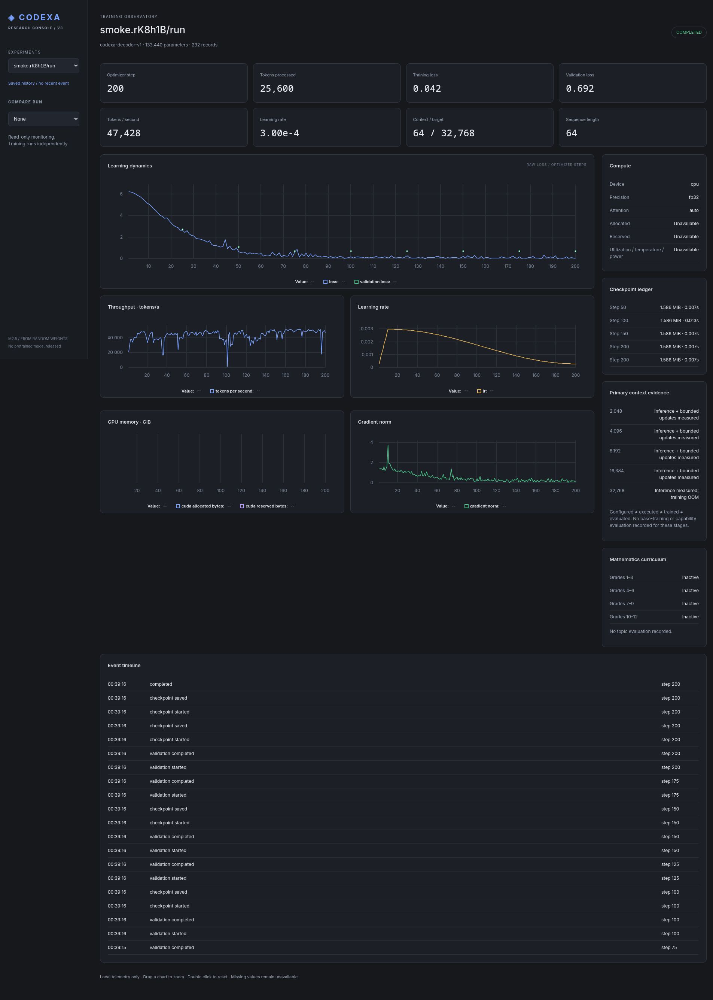

# Codexa-LLM-v3-PyTorch-250M

Codexa v3 is a decoder-only language model implemented locally in PyTorch and initialized from random weights. V1 explored PyTorch; v2 explored NumPy/CuPy; v3 establishes a new, tested PyTorch training foundation targeting 248.69M parameters. There are no pretrained weights, pretrained tokenizers, imported Transformer architectures, inference services, or distillation.

This repository provides a training system, not a pretrained language model. The original sample corpus and tiny memorization test establish engineering behavior, not language competence.

## Install

Python 3.11+ is required; Python 3.13 is the tested environment. Using `uv`:

```sh
uv venv --python 3.13 .venv
source .venv/bin/activate
uv pip install -e '.[dev,release]'
```

For an exact reproduction of the tested environment, use `uv pip sync requirements-lock.txt`, then `uv pip install --no-deps -e .`. The lock records the Linux NVIDIA environment and is not portable to all platforms. For CPU-only installations, install a compatible PyTorch CPU wheel from https://download.pytorch.org/whl/cpu before installing this package. No local CUDA toolkit is required for packaged CUDA runtimes; an appropriate NVIDIA driver is required.

## Tokenizer and smoke training

All commands run from the repository root. `--threads` is a global CLI option (default 4).

```sh
codexa tokenizer train --corpus examples/corpus --vocab-size 512 --output outputs/tokenizers/new-smoke/tokenizer.json
codexa data prepare --corpus examples/corpus --tokenizer outputs/tokenizers/new-smoke/tokenizer.json --output outputs/datasets/new-smoke
codexa train --config configs/smoke.yaml --data outputs/datasets/new-smoke --tokenizer outputs/tokenizers/new-smoke/tokenizer.json --output outputs/experiments/new-smoke --device cpu
codexa train --config configs/smoke.yaml --data outputs/datasets/new-smoke --tokenizer outputs/tokenizers/new-smoke/tokenizer.json --output outputs/experiments/new-smoke --device cpu --resume outputs/experiments/new-smoke/latest.pt
codexa generate --checkpoint outputs/experiments/new-smoke/latest.pt --prompt 'Morning light' --max-tokens 40 --temperature 0.8 --top-k 30 --top-p 0.9 --seed 42
codexa generate --checkpoint outputs/experiments/new-smoke/latest.pt --prompt 'Morning light' --max-tokens 40 --greedy
```

To demonstrate an interrupted run, add `--until 50` to the first training command, then resume without that option. A finished checkpoint resumes as a no-op. Schedule and configuration must remain identical. SIGINT/SIGTERM request a safe stop after the current optimizer step; the resulting checkpoint records that completed step. An exception during an optimizer step leaves the previous checkpoint intact.

The data importer accepts a directory of UTF-8 `.txt` documents or JSONL records with a `text` string. It deduplicates identical document hashes, selects a deterministic 10% validation split (at least one document), and trains BPE exclusively on the remaining documents. Adding corpus documents can change the split; freeze the corpus before a research run. Content-level deduplication does not detect paraphrases or contamination.

Tokenizer training has no destructive normalization and includes all byte symbols. Special strings `<pad>`, `<unk>`, `<bos>`, `<eos>` are reserved; literal appearances are interpreted as special tokens. Ordinary Unicode text, whitespace, and mathematical symbols round-trip. Arbitrary generated bytes may decode with replacement characters. Insufficient text diversity for the requested vocabulary produces an error. The smoke corpus cannot support production tokenizer research.

Packed streams use BOS/document/EOS, little-endian uint32 tokens, and ordinary causal attention across document boundaries. Full sequences share the lookahead token at their boundaries. Remaining tails are unused; unused count is `(token_count - 1) % sequence_length`. No padding is used during training. Dataset and tokenizer hashes are checked at startup and resume. Preparation streams output one document at a time, but corpus ingestion currently retains text in RAM: large-corpus preparation is a future milestone.

## Configurations and training

YAML configurations contain `model` and `training` sections. Unknown fields fail construction; invalid dimensions and schedules raise errors. All sizes use the same architecture.

| Config | Parameters | Layers / width / heads / FFN | Vocabulary | Context |
|---|---:|---|---:|---:|
| smoke | 133,440 | 2 / 64 / 4 / 176 | 512 | 64 |
| 50m | 49,295,872 | 12 / 512 / 8 / 1536 | 16,384 | 1024 |
| 250m | 248,687,488 | 24 / 896 / 14 / 2432 | 16,384 | 2048 |

For larger models first prepare a permitted, sufficiently diverse local corpus and train a **new** 16,384-token BPE. Point training at that tokenizer and corresponding packed data. The primary configuration encodes roughly five billion target tokens, **not an authorized automatic training run**. Benchmark and review the budget before launching it. No large dataset is included or downloaded.

Training uses AdamW, warmup/cosine scheduling, accumulation, gradient clipping, and CUDA BF16 autocast when available. Parameters, gradients, and Adam moments remain FP32; CPU and unsupported devices use FP32. `precision: fp32` disables autocast. A `bf16` request also safely falls back if unsupported. There is no FP16 path or loss scaler. Effective batch sequences = batch size × accumulation; target tokens per update additionally multiply sequence length. Metrics are appended to the run's JSONL file.

Checkpoints include optimizer/scheduler, consumed tokens, sampler order/cursor, all RNG states, configuration, and the tokenizer JSON. Atomic same-directory replacement protects the previous checkpoint from interrupted writes. Exact resume requires the same configuration, data, device type, and precision. Bitwise CPU resumption is tested; GPU kernels, library versions, and hardware can affect numerical reproducibility. Checkpoints from this project use PyTorch's restricted `weights_only` loader.

## Tests and benchmarks

```sh
pytest -q
ruff check .
ruff format --check .
mypy codexa
codexa benchmark --config configs/smoke.yaml --device cpu --sequence 64
codexa benchmark --config configs/50m.yaml --device cuda --sequence 1024
codexa benchmark --config configs/250m.yaml --device cuda --sequence 2048 --steps 3 --warmup 1 --output outputs/benchmarks/250m-benchmark.json
```

Benchmarks use synthetic token IDs and execute real forward/backward/AdamW steps with micro-batch one; use `--accumulation 16` to measure the primary effective batch. CUDA timing synchronizes the device and reports peak allocated memory. Estimates exclude activations unless explicitly measured. OOM is reported without substituting a smaller architecture. Throughput extrapolation from a short run is not a training completion prediction.

At 248,687,488 parameters, FP32 weights occupy 948.67 MiB; gradients another 948.67 MiB; Adam moments about 1,897.33 MiB. This 3.71 GiB subtotal excludes activations, logits, optimizer intermediates, allocator reservation, and CUDA context. BF16 autocast does not halve these FP32 states. Availability of 16GB VRAM alone does not establish that a desired batch fits.

## Mathematics

```sh
codexa math generate --split train --count 20 --output outputs/datasets/arithmetic-train.jsonl
codexa math generate --split test --count 20 --output outputs/datasets/arithmetic-test.jsonl
codexa math evaluate --problems outputs/datasets/arithmetic-test.jsonl --predictions outputs/predictions/predictions.json
```

Predictions are a JSON object mapping stable problem IDs to integer answer strings. Missing or malformed answers count as incorrect. Accuracy is grouped by grade and topic. Reevaluate frozen earlier topic sets after each curriculum stage to detect forgetting.

The implemented prototype generates Grade 1 addition/subtraction within 20, exact verified answers, explanatory steps, difficulty, and stable split identities. Different random seeds change ordering, not split membership; addition operands are canonicalized to avoid reversed-pair leakage. It is a synthetic engineering demonstration, not verified educational content. See [the roadmap](docs/TRAINING_ROADMAP.md) for Grades 1–12. Mathematics training remains deferred.

See [architecture](docs/ARCHITECTURE.md) and [implementation measurements](docs/IMPLEMENTATION_REPORT.md).

## Public development and release status


Implemented and locally tested: custom architecture, BPE, packing, CPU/CUDA smoke training, exact CPU resume, generation, arithmetic prototype. Experimental: short GPU throughput extrapolation and release infrastructure. Planned: production datasets, actual base pretraining and Grades 1–12 training. **No trained public Codexa model artifacts are released.** Hosted CI is configured but has not run for this local overhaul; no passing hosted-CI badge is claimed.

Code supports Python 3.11–3.13; the verified local reference is Python 3.13/PyTorch 2.11.0+cu130. CPU CI covers the declared interpreter matrix; hosted results are pending. Prefer the pinned CPU profile for development:

```sh
uv venv --python 3.13 .venv
uv pip sync requirements-cpu-lock.txt
uv pip install --no-deps -e .
source .venv/bin/activate
python scripts/verify.py
sh scripts/smoke.sh
```

For the reference NVIDIA environment, sync requirements-lock.txt instead. These profiles include release dependencies. General editable installation is `uv pip install -e '.[dev,release]'`; use the locks for reproduction. Inference exports require the optional release extra.

## Repository organization

Source stays in codexa (architecture, tokenizer, data, training, inference, evaluation, mathematics, release). configs retains smoke/50M/250M configuration paths and numerical values. examples/corpus contains the original public fixtures. tests holds regression tests; scripts holds bounded commands. docs contains public technical and engineering evidence. release contains local model-card and metadata proposals; .agents/skills contains reusable reviewed workflows. All ephemeral data, checkpoints, logs, predictions and exports live under ignored outputs. Agent scratch goes under ignored .agents/scratch.

Existing saved smoke outputs moved to outputs/experiments; token arrays to outputs/datasets/smoke and the original tokenizer to outputs/tokenizers/smoke. The hash-verified [migration map](docs/engineering/MIGRATION_MAP.md) records every move. Existing training commands still accept explicit paths. New runs, prepared datasets and tokenizer files refuse accidental replacement. Use the smoke script for an automatically fresh run.

## Safe inference artifacts and evaluation

```sh
codexa release fixture --corpus examples/corpus --output outputs/exports/fixture-NEW
codexa release preflight --artifact outputs/exports/fixture-NEW --verification-report outputs/logs/verification.json
codexa generate --export outputs/exports/fixture-NEW --prompt 'Test' --max-tokens 8 --greedy
codexa evaluate --checkpoint outputs/experiments/smoke/latest.pt --data outputs/datasets/smoke
```

Fixture generation is random and meaningless; it tests serialization. Preflight never uploads. [Release instructions](docs/RELEASE_PROCESS.md) explain trusted native-checkpoint export, artifact licensing, versioning and publication blockers. Custom loading is implemented; Transformers, GGUF and llama.cpp compatibility are not claimed.

## Research, contribution and limitations

The research motivation is an independently implemented small base model followed by measured progressive mathematics learning, with earlier skills retained. See the [numbered roadmap](docs/TRAINING_ROADMAP.md), [architecture](docs/ARCHITECTURE.md), [data policy](docs/DATASETS.md), [evaluation methodology](docs/EVALUATION.md), [reproducibility](docs/REPRODUCIBILITY.md), [benchmark evidence](docs/benchmarks/README.md), [contribution guide](CONTRIBUTING.md), and [security policy](SECURITY.md).

Code is licensed Apache-2.0; the twelve original corpus fixtures are CC0-1.0. External datasets and model weights require separate review and are not automatically relicensed. No large-scale training or model publication is authorized by installation. Small models can produce incorrect, biased or harmful text; neither loss reduction nor fluent generated steps establishes factual or mathematical reliability. Keep generated outputs out of consequential uses without independent verification.

## M2.5: context and research dashboard

The primary model now has explicit 2K/4K/8K/16K/32K profiles, opt-in linear RoPE scaling, cached autoregressive inference and activation checkpointing. Defaults retain original 2K positional semantics and the parameter count. Prompt plus generation budget must fit; generation no longer silently truncates.

```sh
codexa dashboard --list
codexa dashboard --port 8765
codexa context benchmark --mode both --output outputs/benchmarks/m25-context.json
```

Start normal training or `sh scripts/smoke.sh` in another terminal. New runs write independent structured telemetry; the viewer can close/restart without stopping training. Old saved metrics are readable. See [context, hook API and dashboard guide](docs/M25_CONTEXT_AND_TELEMETRY.md), [reference audit](docs/engineering/M25_REFERENCE_AUDIT.md) and [M2.5 report](docs/engineering/M25_REPORT.md).


