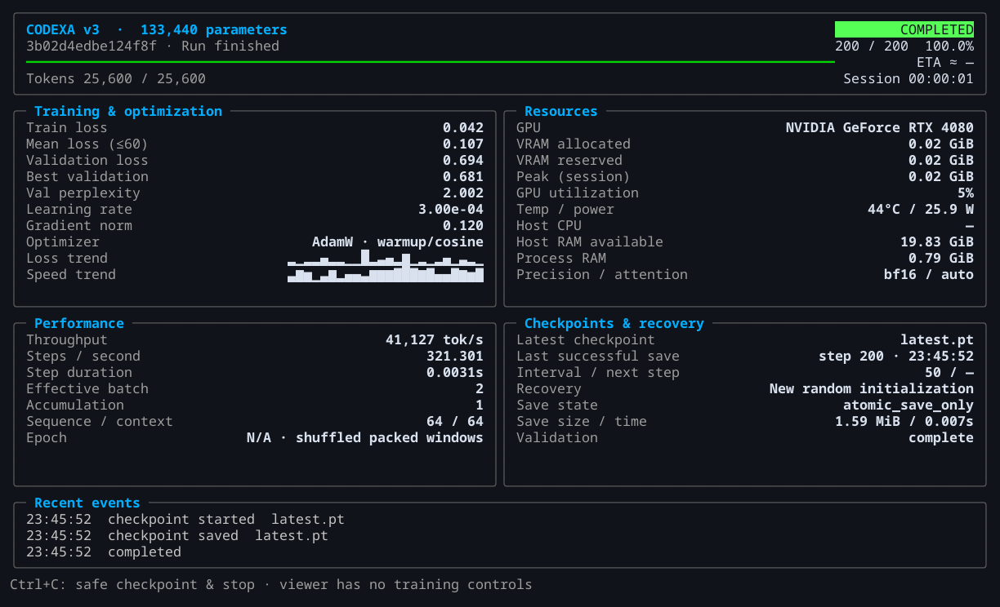

# Codexa v3

**A 249M-parameter language model, built and trained from scratch in PyTorch.**

[](https://github.com/golba98/Codexa-LLM-v3-PyTorch-250M/actions/workflows/ci.yml) [](pyproject.toml) [](LICENSE)

Codexa implements its own decoder-only Transformer, tokenizer pipeline, training loop and checkpoint recovery. Training starts from random initialization. The research goal is general language learning, followed by Grade 1–12 mathematics.

[Quick start](#quick-start) · [Documentation](#documentation) · [Research results](reports/README.md) · [Contributing](CONTRIBUTING.md)

## Project status

| Workstream | Where it stands |
| --- | --- |
| Base training | **500,006,912 targets completed.** [Run and validation results →](reports/training/base-500m.md) |
| Language continuation | An additional **500M English tokens** from the pinned Wikipedia stream; confirmed running on **11 November 2026**. [Training guide →](docs/training.md) |
| Language quality | The baseline still produces repetition, factual errors and incoherent responses. [Evaluation →](reports/evaluation/language-baseline.md) |
| Mathematics | Corpus development and review; training admission remains pending. [Dataset guide →](docs/datasets.md#mathematics-corpus) |

**No public trained weights are available.** You can inspect the implementation and run the small engineering fixtures locally. Inference with a trained model requires your own compatible checkpoint.

## The model

| Property | Primary configuration |
| --- | --- |
| Parameters | **248,687,488** |
| Decoder | 24 layers · width 896 · 14 attention heads |
| Feed-forward | SwiGLU · intermediate width 2,432 |
| Normalization and positions | RMSNorm · RoPE |
| Vocabulary | 16,384-token BPE · tied input/output embeddings |
| Training context | 2,048 tokens |

The implementation lives in [codexa/architecture](codexa/architecture/). Experimental context profiles extend to 32K; learned long-context capability has not been established. See the [architecture guide](docs/architecture.md) for equations, initialization and exact parameter accounting.

## Quick start

Use **Python 3.11–3.13**. Linux is the verified platform. From the repository root:

```sh
python -m pip install uv==0.13.5
uv venv --python 3.13 .venv
uv pip sync requirements-cpu-lock.txt
uv pip install --no-deps -e .
source .venv/bin/activate
codexa --help
```

The CPU lock is enough to explore the project. For the recorded CUDA environment and optional data tools, see [environment setup](CONTRIBUTING.md#environment-and-checks).

### Run a small training fixture

```sh
sh scripts/training/smoke.sh
```

This trains a **133,440-parameter fixture on CPU**, tests stop/resume and generates sample text in a fresh ignored output directory. It checks the pipeline; its outputs do not demonstrate general language ability.

### Generate from a checkpoint

With a trusted native checkpoint that contains its tokenizer:

```sh
codexa generate --checkpoint /path/to/checkpoint.pt --prompt 'Morning light' --max-tokens 32 --greedy
```

Replace the path with your local checkpoint. The command does not download weights. [Training and inference](docs/training.md) explains recovery and context limits; [release formats](docs/release.md) covers SafeTensors and Codexa's inference loader.

## Training interface



*The interface above shows the 133,440-parameter smoke fixture. Its loss, memory and throughput values are specific to that fixture.*

The terminal view tracks loss, validation, throughput, resources and recovery points. An independent viewer can reconnect to a running session without controlling training. See [monitoring a run](docs/training.md#monitor-a-run) for terminal and browser options.

## Documentation

### Get started

[Install and contribute](CONTRIBUTING.md) · [Run, resume and monitor training](docs/training.md) · [Browse all documentation](docs/index.md)

### Understand the implementation

| Guide | What you will find |
| --- | --- |
| [Architecture](docs/architecture.md) | Decoder blocks, initialization, objective and parameter counts |
| [Datasets and tokenizer](docs/datasets.md) | Source provenance, streaming, split protection and mathematics materials |
| [Roadmap](docs/roadmap.md) | Language and mathematics goals, evaluation gates and remaining work |
| [Release](docs/release.md) | Artifact formats, local export checks and publication requirements |

### Review the research

Start with the [research reports](reports/README.md) for the completed run, language evaluation, mathematics status and measured engineering performance. Historical source decisions and readiness snapshots are labeled separately; original evidence and checksummed archives remain linked from each report.

## Development

```sh
python scripts/verify.py
```

Runs repository checks, Ruff lint and format checks, mypy, report consistency checks and pytest using tiny CPU fixtures. For checks that deliberately exclude training tests:

```sh
python scripts/verify.py --forward-only
```

The model profiles are [primary](configs/250m.yaml), [intermediate](configs/50m.yaml) and [smoke](configs/smoke.yaml). See [CONTRIBUTING](CONTRIBUTING.md) for script locations and optional dependencies.

## License

Source code is **Apache-2.0**; original corpus fixtures are **CC0**. Dataset and trained-weight permissions require their own review. See [third-party notices](THIRD_PARTY_NOTICES.md), the [release guide](docs/release.md) and [security policy](SECURITY.md).

Weights, native checkpoints, downloaded corpora and private evaluations stay outside Git. This repository contains Codexa v3; the earlier PyTorch v1 and NumPy/CuPy v2 projects are independent.
