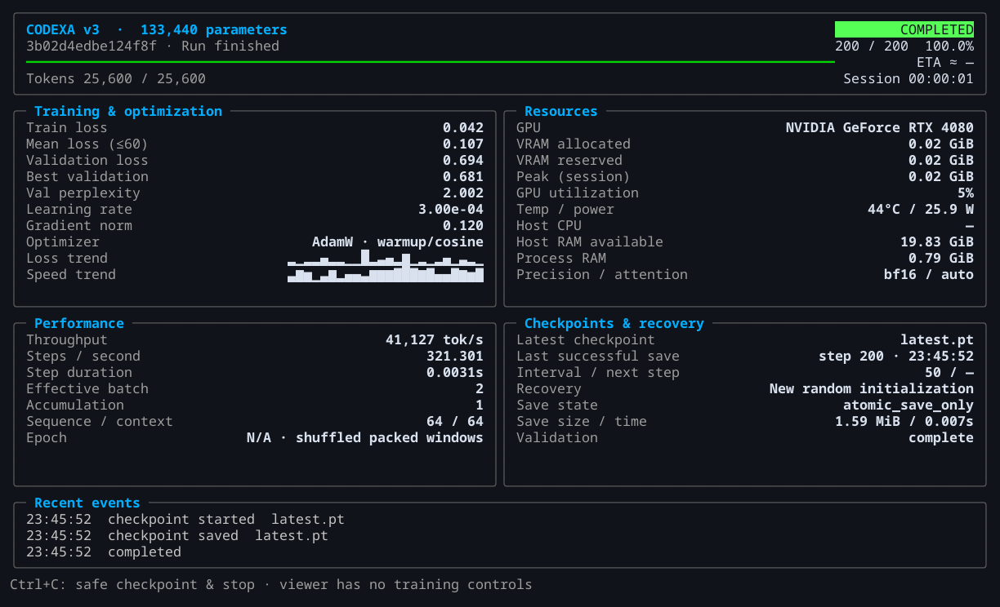

# Terminal training dashboard implementation report

## Outcome and reference selection

The original **v1 Rich monitoring interface** is now adapted into v3's training CLI, preserving its bordered two-column panels, cyan/slate hierarchy, colored lifecycle badges, progress bar, loss/speed sparklines and compact fallback. This is a working local terminal interface driven by real training events. It does not launch the browser, bind a network port, deserialize checkpoints for rendering, or introduce a second telemetry format.

The reference inspection covered the v1/v2 workspace and repository instructions, v1 integration monitoring/dashboard.py, render.py and reader.py, v1 LLM-Training viewer.py and conversational/trainer attachment hooks, and v2 training/progress.py with its trainer integration. V1's Rich interface was selected over its simpler ANSI/Kitty viewer and v2's single-line progress display. Detailed file-level reuse/rejection and licensing decisions are in [the guide](../TERMINAL_DASHBOARD.md). Earlier projects were strictly read-only; their source/environment/history/runs and historical checkpoints were not modified or executed. Original MIT attribution/full notice is retained for the adapted v1 rendering helpers/layout.

## Implementation

- `codexa/training/terminal/state.py`: bounded event projection, measured metrics, smoothing, best validation, session peak VRAM, resume and lifecycle state.
- `codexa/training/terminal/render.py`: adapted v1 panel composition and sparklines; full, medium, compact and tiny layouts; unavailable values remain unavailable.
- `codexa/training/terminal/worker.py`: independent Rich Live renderer, alternate-screen restoration, resizing, owner-exit detection, no PyTorch or stdin grabs.
- `codexa/training/terminal/__init__.py`: optional dependency/TTY selection, nonblocking bounded Unix socketpair transport, throttled snapshots, observer failure isolation and bounded child shutdown.
- `codexa/training/terminal/V1_LICENSE`, THIRD_PARTY_NOTICES.md and package license metadata: preserve adapted MIT source attribution.
- `codexa/training/trainer.py`: default automatic/explicit/headless UI integration through existing callbacks; validation batch progress; optional backward-compatible best-validation checkpoint field. Normal headless validation output is retained. If an active TUI fails, training persists metrics without attempting synchronous log writes to that potentially broken terminal.
- `codexa/training/callbacks/telemetry.py`: extend existing optional sampling to Linux host CPU/RAM; keep GPU sampling asynchronous, now every two seconds. Renderer failures persist warning events without synchronous stderr writes. Other callbacks retain their existing warning behavior.
- `codexa/cli.py`: `train --ui auto|terminal|none` with auto default. Existing required arguments and browser command are preserved.
- `pyproject.toml`, both requirements lockfiles and scripts/lock_dependencies.py: optional Rich extra, pinned Rich/transitives and PTY test dependencies, no existing dependency upgrades. MANIFEST includes curated captures/license.
- `tests/test_terminal.py`, scripts/terminal_acceptance.py: real CPU PTY acceptance plus renderer, callback, interruption/resume, missing metrics and failure tests.
- README, docs/TERMINAL_DASHBOARD.md, docs/M25_CONTEXT_AND_TELEMETRY.md, this report, terminal-acceptance.json and two curated PNGs: public usage/provenance/evidence. Raw ANSI/SVG, run telemetry and checkpoints remain ignored under outputs/terminal-acceptance.

Core training works without Rich. The optional terminal extra is required for the live interface; both locked development profiles include it. A noninteractive/dumb terminal falls back safely. The viewer refreshes at about 4 Hz, with a final lifecycle update; it can drop display snapshots under pressure while all raw events continue to persist. A blocked renderer cannot hold the optimizer thread. Ctrl+C stays owned by the trainer, which finishes its update and safely checkpoints before shutdown.

## Real acceptance evidence

All runs used the original local sample corpus/tokenizer, the 133,440-parameter smoke architecture and fresh output directories. No 250M pretraining or long-duration run was launched. Full evidence with commands is in [terminal-acceptance.json](terminal-acceptance.json); raw evidence is retained locally under ignored outputs/terminal-acceptance.

| Acceptance | Real outcome |
|---|---|
| CPU auto selection, 120×36 | 200 updates, 25,600 target tokens; final loss 0.04200207069516182; live rendered steps included 0, 22, 43, 87, 134, 193 and 200 |
| Runtime resize 120×36 → 60×24 | 200 updates; compact layout selected; identical CPU final loss |
| RTX 4080 CUDA/BF16, final colored full view | 200 updates; final loss 0.042066752910614014; real GPU and host samples, validation and checkpoint events; live displayed steps 0, 1, 56, 114, 174 and 200 |
| Real SIGINT after progress | Stopped safely at completed global step 25, saved checkpoint, persisted interrupted; exact response step depends on signal delivery timing |
| Resume that checkpoint in a new terminal run | 75 further updates to global step 100, paused intentionally, final loss 0.17118747532367706; resume indicator and checkpoint-aware best loss restored |
| Explicit compact view, 60×24 | 200 updates; actual changing loss and step values, final CPU loss identical |

Every acceptance run exited successfully and recorded alternate-screen entry/restoration, cursor restoration and unchanged termios settings. The final colored captures were rasterized from parsed **actual PTY cells**, not a simulated training display. The GPU screenshot is a tiny smoke model, not the primary 250M model. Its last-step throughput is an instantaneous smoke metric, not a benchmark or general performance claim. Host CPU can remain unavailable in runs shorter than the second sample; it is never filled with zero.



[Actual compact terminal capture](../images/terminal-training-compact.png)

## Regression gates

Baseline before changes: **40 tests passed**, Ruff lint/format and mypy passed. The expanded suite adds 14 terminal cases for a total of **54 tests**. Run:

```sh
.venv/bin/python scripts/verify.py
.venv/bin/python -m build --outdir outputs/packages-terminal
.venv/bin/codexa train --help
```

The suite includes actual CLI startup under PTYs in auto/full and explicit/compact modes; live steps/losses; validation and checkpoint events; exact CPU parameter equality with and without the observer; interruption and best-validation resume; absent GPU telemetry; unknown budgets; narrow/tiny sizes; noninteractive and missing-Rich selection; nonblocking full transport buffers; and an actual killed renderer while training completes and checkpoints. Existing tests continue to cover exact CPU RNG/optimizer/scheduler/sampler recovery, causal attention, 32K positions/cache parity, the exact **248,687,488** primary parameter count, browser serving/restarts and SafeTensors/release round trips. Final `scripts/verify.py` passed all 54 tests, Ruff lint/format and mypy. Wheel/sdist builds passed; a separate installed wheel imported the worker outside the checkout without importing PyTorch, and included the v1 license plus existing browser assets. Release-fixture preflight passed validation and correctly remained non-publish-ready. Hosted CI was not pushed/run.

No architecture, 32K profile, optimizer objective, initialization, model state-dict naming or tokenizer/data artifacts changed. Native checkpoint version remains 1; the additional best_validation_loss key is optional on load. The original native v1 smoke checkpoint restored step 200 / 25,600 tokens with best loss unavailable, and existing inference still executed. All original preserved artifact hashes matched the migration record. Final verification source identity and command results are recorded under outputs/logs/verification.json.

## Limitations and next work

The transport is POSIX-specific and only Linux was verified. Non-TTY and missing-Rich environments on supported systems run headless; broader OS compatibility is unverified. Secondary panels are omitted at small sizes, and very brief validation/save phases can finish between refreshes, leaving their events as the evidence. ETA is based on recent observed wall-time intervals and can vary with future validation/I/O. There is no exact checkpoint byte-progress callback, so saving is explicitly indeterminate. Native save integrity remains atomic_save_only, not a new independent verification claim. The renderer currently has no interactive keys beyond the trainer's Ctrl+C. GPU system samples retain their recorded physical-GPU scope and should not be mistaken for process-only utilization.

A renderer killed or blocked in terminal output is isolated and its shutdown is bounded. If the terminal itself is disconnected or unable to accept bytes, screen restoration is best-effort through a separate nonblocking descriptor; this cannot guarantee delivery to broken hardware. Synchronous training checkpoint/telemetry storage remains the existing I/O responsibility. No new long-context language capability or pretrained performance is claimed.

The next major engineering milestone remains bounded-memory corpus/tokenizer preparation and general-language pretraining readiness. Nothing was pushed, published or deployed.
