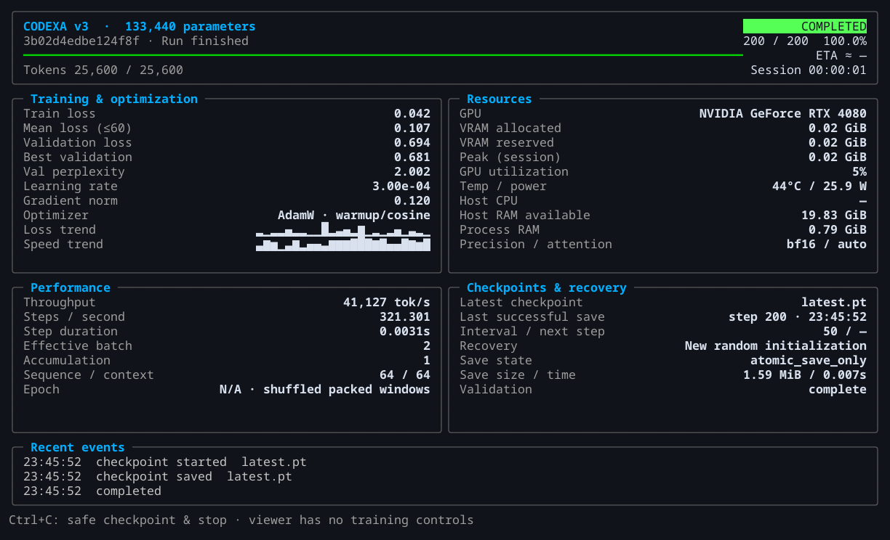

# Training, inference and recovery

Start with the CPU fixture to exercise the pipeline. Use native checkpoints for exact recovery and trusted-checkpoint generation; production continuation has separate data, authorization and compute requirements.

[Documentation](index.md) · [Architecture](architecture.md) · [Dataset guide](datasets.md)

## Run a CPU fixture

From the repository root in the [pinned environment](../README.md#quick-start):

```sh
sh scripts/training/smoke.sh
```

The script trains the **133,440-parameter smoke model** on the original [CC0 corpus](../examples/corpus/PROVENANCE.md). It fits a fixture tokenizer, packs data, checks stop/resume and generates text. Each invocation uses a fresh `outputs/experiments/smoke.*` directory and preserves its results.

This checks the engineering pipeline. Fixture output and loss do not measure general language ability. The full verifier uses similarly small, disposable CPU fixtures.

## Generate from a checkpoint

A trusted native checkpoint includes the tokenizer needed for generation:

```sh
codexa generate --checkpoint /path/to/checkpoint.pt --prompt 'Morning light' --max-tokens 32 --greedy
```

Supply your own checkpoint path; no public trained weights are distributed. For SafeTensors exports, use Codexa's loader as described in the [release guide](release.md).

Generation enforces a context budget and supports a per-request key/value cache. The baseline trained at 2,048 tokens; experimental profiles reach 32K with explicit linear RoPE scaling. Profile support does not establish learned long-context reasoning.

## Resume a run

Native checkpoint **version 1** stores model weights, AdamW state, scheduler, sampler, CPU/CUDA/Python/NumPy random state, counters, configuration and tokenizer identity.

```sh
codexa train --help
```

The CLI accepts `--resume`, `--data`, `--tokenizer`, `--config` and `--output`. Restore a trusted file with compatible configuration and data into a fresh output directory. For a rolling run, `--resume /path/to/run/training` resolves the newest retained file that passes integrity checks, warning and falling back to the previous file if needed.

Exact resume preserves the existing schedule. A changed dataset or an extension to a completed schedule needs explicit continuation preparation. SafeTensors inference exports contain no optimizer recovery state.

### Determinism and storage

- `--deterministic` enables deterministic PyTorch algorithms. CUDA replay also needs `CUBLAS_WORKSPACE_CONFIG=:4096:8`. Exact replay is limited to tested software/hardware combinations.
- `--checkpoint-volume-uuid UUID` verifies the filesystem and a 20 GiB free-space reserve before writes. Phase-specific rules can require more space.
- Keep the intended volume mounted. An absent volume must not be replaced with a fallback directory.

## Language continuation

The preserved [base run](../reports/training/base-500m.md) completed **500,006,912 target tokens**. The current phase adds exactly **500,000,000 English targets**, ending at **1,000,006,912 cumulative targets**.

The run's event log confirmed completed optimizer updates on **11 November 2026**. That is a dated execution observation, not a completion claim. The [old 1B readiness report](../reports/language/continuation-readiness.md) remains a historical assessment from before this phase.

### Source and launch checks

The streaming loader reads the pinned English Wikipedia source without constructing a replacement token corpus. Its policy binds the source, frozen tokenizer, protected exclusions, rights, quality, capacity and compute evidence. Seven source hashes participate in approval; policy changes require fresh hashes and evidence bindings.

`codexa continuation stream-prepare` prepares a fresh phase only after source/configuration-bound authorization passes. Preparation itself does not train. The current phase requires the exact 500M budget and real optimizer/exact-resume evidence. The legacy healthcheck covers historical 50M/100M array phases.

Forward-only provider checks use `CODEXA_NO_TRAINING=1`, `--forward-only` and a mandatory byte cap of at most 64 MiB. They perform no optimizer updates. Provider access and source quality do not independently authorize training.

### Provider cache

| Setting | Behavior |
| --- | --- |
| Disk budget | 2 GiB of compressed provider blocks in the run's `stream-cache` directory |
| Network reads | Bounded 1 MiB HTTP ranges |
| Identity checks | Pinned ETag, exact content range and response length |
| Cache integrity | SHA-256 checksum per stored block |
| Free-space reserve | 40 GiB |

Duplicate checks and recovery can reuse the exact fetched bytes. Missing blocks are fetched again; eviction removes only owned cache blocks. The cache is disposable and adds no token-array or sampler state to native checkpoints.

## Rolling recovery

For the current continuation:

```yaml
training:
  checkpoint_every_tokens: 50000000
  checkpoint_keep: 2
```

The first completed update crossing each phase-token milestone triggers a save. Omitting `checkpoint_every_tokens` preserves legacy step-based saving. Native v1 file loading remains supported; new configuration fields have defaults.

The continuation retains AdamW moments and uses a fresh **15,259-update cosine schedule**: learning rate 0.0001, minimum 0.00001 and 100 warmup updates. The final update consumes the remaining **25,856 targets**.

### What is saved

| Artifact | Purpose |
| --- | --- |
| Rolling native checkpoints | Two retained full recovery points, including optimizer and stream state |
| `recovery.json` | Atomically published manifest with latest/previous entries and checksums |
| `checkpoint-history/` | Lightweight receipts for published saves |
| `final.pt` | Final full recovery state, published as latest at completion |
| `best-weights.pt` | Optional private weights-only artifact for improved validation loss |

A new rolling file is read back and compared with the complete live state, including scheduler, RNG and stream cursor/buffers. Only after manifest publication are obsolete run-owned files removed. Writes require the intended volume and transaction space above the 40 GiB reserve.

A failed transaction stops training without deleting the existing recovery points. Updates since the last verified save can still be lost. Private best weights are neither a full recovery checkpoint nor a public inference export.

## Monitor a run

Training selects the Rich terminal interface on a capable TTY; `--ui none` runs headlessly. Ctrl+C in the trainer requests a checkpoint after the current update. Rendering runs separately so a failed renderer does not stop optimization.

For an independent viewer:

```sh
python -m codexa.training.terminal --run /path/to/run/training
```

Run trainer and viewer in separate tmux sessions. The viewer replays and follows `events.jsonl`, including resumed sessions; closing it leaves training running. The terminal shows token milestones, retained recovery steps and disk usage.

**Update throughput** measures an update; **effective session throughput** also includes loading stalls, validation and saves. ETA uses elapsed time between recent updates. `codexa dashboard --help` describes the independent localhost browser viewer and telemetry options.



*This screenshot is from the 133,440-parameter fixture. Displayed performance values apply to that fixture.*

The production phase keeps scheduled validation, verifies its final checkpoint and stops at the fixed token budget. Generation evaluation, mathematics training and follow-on experiments are separate tasks.

## Evaluate results

Protected evaluation tools live in `codexa/evaluation`; analysis and plotting tools live in `scripts/evaluation`. Compare checkpoints with identical protected prompts and decoding settings, independent checkpoint-blinded scoring, and separate grammar/coherence/relevance/completeness/task-success judgments. Keep raw outputs private.

Corpus loss and automatic answer proxies do not establish factual accuracy or conversational ability. Read the [language baseline](../reports/evaluation/language-baseline.md), [recorded benchmarks](../reports/benchmarks/recorded-performance.md) and [roadmap](roadmap.md) before interpreting results.
